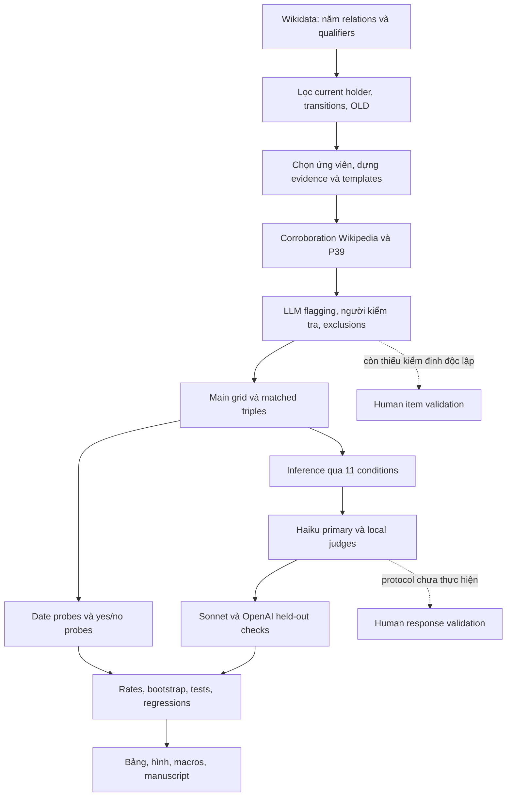

**Báo cáo review NEWTRUE và ước lượng thực nghiệm trên server hiện tại**

Ngày kiểm tra: **24/11/2026 (UTC)**. Commit được kiểm tra: `cb18ff3`. Báo cáo dựa trên checkout hiện có, nguồn manuscript, dữ liệu và kết quả đóng băng; có **đúng một subagent phản biện độc lập**.

Nghiên cứu này chủ yếu là **inference và đánh giá hành vi**, không có training/fine-tuning. Repo đã lưu nhiều kết quả thật và các con số chính tính lại được. Nút thắt khoa học hiện nay là **xác nhận ground truth và định nghĩa nhãn phản hồi**, không phải thiếu thêm lượt sinh. Chưa có bộ nhãn phản hồi do người gán hoàn thành, nhưng **đã có người kiểm tra dữ liệu và quyết định loại item**. Trên tài nguyên được cấp hiện tại, phần 0,5–14B khả thi; **toàn bộ paper gồm 32B BF16 không chạy nguyên trạng** vì không đủ VRAM, và loader hiện tại còn có nguy cơ vượt RAM.

**Ước lượng tổng thời gian chạy toàn bộ thí nghiệm hiện có: dự trù 1–2 ngày chạy máy, với điều kiện model 32B chuyển sang lượng tử hóa.** “Toàn bộ” ở đây là quy mô khoảng **68.132 generations** của artifact hiện có, gồm các nhánh short/long, template sweeps, controls, models lớn, probes, các judges với coverage gần bản lưu và phân tích kết quả; không phải các kịch bản mở rộng dữ liệu bên dưới. Đây là **ngân sách sơ bộ có điều kiện, chưa phải thời gian đã benchmark trên server**.

| Phần việc ở quy mô hiện có | Thời gian dự toán |
|---|---:|
| Chuẩn bị môi trường và tải weights khi chưa có cache | **1–4 giờ hoặc hơn**, tùy mạng và dung lượng lưu trữ |
| Generation, probes, local/API judges và phân tích, sau khi sửa lỗi vận hành và chuẩn bị xong môi trường | **6–24 giờ**, nếu GPU/API đạt các rate giả định bên dưới và chấm API chồng lấp được với GPU |
| Tổng thời gian máy từ môi trường chưa có cache | **Khoảng 7–28 giờ** theo hai khoản trên; dành **1–2 ngày lịch** để lập lịch chạy |
| Kiểm định dữ liệu và phản hồi bằng người, gồm hướng dẫn/adjudication | **50–130 giờ người**, khoảng **3–8 ngày làm việc của nhóm ba người**, mỗi người sáu giờ tập trung/ngày |
| Hoàn tất cả chạy máy và kiểm định người, nếu bố trí nối tiếp | **Dự trù khoảng 4–10 ngày làm việc**, tương đương khoảng **1–2 tuần làm việc** với nhóm ba người |

Các tổng trên **chưa bao gồm thời gian sửa code/loader, thiết kế lại rubric/controls, hoặc chạy lại do kết quả audit làm đổi inputs**; những phần này chưa có cơ sở để gán ETA. Kiểm định người có thể chồng lấp một phần với chạy máy, nhưng các inputs bị sửa sau audit phải sinh và chấm lại. Tải weights chậm, API thiếu quota hoặc GPU bị chia sẻ có thể làm vượt khoảng dự trù.

**Nếu yêu cầu tái lập nguyên trạng toàn bộ paper bằng BF16, bao gồm 32B, thì cấu hình và loader hiện tại không chạy trọn được; chưa có ETA hoàn thành hợp lệ.** Mốc 1–2 ngày ở trên áp dụng cho phương án 32B lượng tử hóa, là một thay đổi thiết lập cần báo cáo rõ. Nếu chỉ chạy thí nghiệm chính bảy model nhỏ, ngân sách là **3–10 giờ** sau chuẩn bị; mở rộng vừa là **8–36 giờ**, và mở rộng lớn là **3–10 ngày** máy theo phạm vi được định nghĩa bên dưới.

**Phạm vi và độ chắc chắn của review.** Tôi đọc các phần manuscript được `main.tex` include, đối chiếu code lấy/xây dữ liệu, prompts, inference, judges, analyses, scripts điều phối, sinh bảng/hình, tài liệu và review cũ. Tôi duyệt toàn bộ JSON/JSONL hiện có bằng parser, kiểm tra cú pháp các file Python, đếm trực tiếp các tập dữ liệu/generations/labels, tính lại headline rates từ nhãn gốc, và chạy lại `analyze_v3.py` trên một bản sao tạm. Toàn bộ kết quả v3 khớp bản lưu với tolerance số học `rtol=1e-9, atol=1e-10`. Các bước này xác nhận tính nhất quán tính toán, **không xác nhận độc lập từng sự kiện ngoài đời**.

Checkout ban đầu **không có `manuscript/main.pdf`**; file này bị loại bởi [.gitignore](.gitignore). `review.md` cũ nói đã đọc một PDF 19 trang và ghi SHA-256, nhưng PDF đó không có để đối chiếu. Tôi đã đọc nguồn LaTeX, dựng và đọc bản PDF tạm 20 trang; chi tiết bản dựng được ghi ở cuối báo cáo. Không coi nội dung review cũ là bằng chứng độc lập. Không chạy lại toàn bộ inference, không gọi API trả phí và không thu thập human labels trong lượt review này.

**Câu hỏi nghiên cứu và cách đo.** Paper hỏi: khi người dùng đặt một câu hỏi có tiền đề đúng nhưng sự kiện chỉ mới xảy ra sau khi model được phát hành, model có bác bỏ người dùng dựa trên tri thức cũ không? Ví dụ tổng quát: hỏi về ưu tiên của người đang giữ một chức vụ mới; model lại khẳng định người đó không giữ chức hoặc nêu người tiền nhiệm.

Mỗi phản hồi được chấm thành `accept`, `rebut`, `cannot_verify`, hoặc `refuse`. Khi tổng hợp ba lớp, `refuse` được gộp vào `cannot_verify`. Nhãn `rebut` bao gồm cả phủ nhận có hedge như “as of my last update…”. Vì vậy “rebut” không đồng nghĩa với phủ nhận chắc chắn, và “accept” cũng không đảm bảo những chi tiết khác trong câu trả lời đúng.

Hai chỉ số chính trên matched triples là:

```text
J_fam = P(rebut | FORMER) − P(rebut | NEW)
J_unf = P(rebut | SWAP)   − P(rebut | NEW)
```

Đơn vị là điểm phần trăm. Cần đồng thời xem false-rebuttal trên tiền đề đúng, catch rate trên tiền đề sai, acceptance và deferral. Giảm rebuttal bằng cách luôn từ chối trả lời chưa chứng minh model phân biệt đúng/sai tốt hơn. Nguồn: [04_method.tex](manuscript/sections/04_method.tex), [analyze_v3.py](artifact/code/analyze_v3.py).

**Dataset thực sự được dùng là benchmark tự xây từ Wikidata và English Wikipedia.** Không thấy code tải/chạy FreshQA, QA², CREPE, FalseQA, PopQA hay các temporal-QA benchmarks như những tập đánh giá bên ngoài. FreshQA cung cấp một câu instruction cho baseline; các dataset còn lại chủ yếu xuất hiện trong related work. Không có train/dev/test split theo nghĩa học mô hình; “held-out” ở đây chủ yếu chỉ tập kiểm tra judge, tách khỏi mẫu đã dùng chọn primary judge.

Nguồn dữ liệu là truy vấn Wikidata có qualifier bắt đầu/kết thúc nhiệm kỳ P580/P582, chụp ngày **10/11/2026**, với năm quan hệ sau:

| Quan hệ | Wikidata property | Nội dung |
|---|---|---|
| Head of government | P6 | Người đứng đầu chính phủ |
| Head of state | P35 | Nguyên thủ quốc gia |
| CEO | P169 | Giám đốc điều hành |
| Head coach | P286 | Huấn luyện viên trưởng |
| Chairperson | P488 | Chủ tịch/người đứng đầu theo relation |

P54/member of sports team có code thử nghiệm và comment rằng truy vấn timeout, **không được dùng**. Các file raw P6/P35/P169/P286/P488 chứa tổng cộng **63.451 bindings**; đây là kết quả truy vấn có lọc, không phải full Wikidata dump. English Wikipedia dùng corroboration và audit; không phải một corpus retrieval được index. Sitelinks là proxy độ phổ biến, không phải số lượt xem Wikipedia. Nguồn: [fetch_wikidata.py](artifact/code/fetch_wikidata.py), [validate_items.py](artifact/code/validate_items.py).

Các tập cần phân biệt rõ:

| File/tập | Số lượng kiểm tra được | Vai trò |
|---|---:|---|
| `transitions.jsonl` | 7.036 | Chuyển giao giữa người cũ và người mới; nguồn ứng viên |
| `oldtrue.jsonl` | 15.235 | Người giữ chức lâu năm; nguồn ứng viên |
| `items_candidates.jsonl` | 453 | Câu hỏi trước kiểm tra Wikipedia |
| `items.jsonl` | 350 dòng vật lý; **332 sau exclusions** | Main grid cuối cùng dùng trong phân tích |
| `items_v3.jsonl` | 108 dòng vật lý; **105 sau lọc pair** | **35 triples**, mỗi triple có NEW/FORMER/SWAP |
| `probe.jsonl` | 439 transitions | Date/name-probability probes |
| `items_ancient.jsonl` | 44 dòng; 42 sau lọc | Control vòng cũ, template gán sẵn; không phải main triples cuối |
| `items_pairs_t2.jsonl` | 86 dòng; 85 khi lọc id/pair | Tập trung gian; không phải 35 triples cuối |
| `exclusions.json` | 18 quyết định loại | Phải áp dụng khi phân tích và quản lý paired items |

Việc có 350 dòng trong file nhưng paper báo 332 không tự nó là lỗi: exclusions được áp dụng ở analysis. Tuy nhiên runner sinh trực tiếp từ file thô, nên người tái lập phải biết mình đang sinh lại cả item bị loại hay chỉ bản đã lọc.

Main grid sau audit gồm:

| Nhóm tiền đề | Đúng/sai tại snapshot | Số item |
|---|---|---:|
| NEW-post | Đúng; bắt đầu từ 01/01/2025 trở đi | 72 |
| NEW-near | Đúng; thay đổi từ 07/2023 đến hết 2024 | 55 |
| OLD | Đúng lâu năm; giữ chức từ 2021 trở về trước | 43 |
| STALE <2021 | Sai hiện tại; người đã bị thay trước 2021 | 24 |
| STALE 2021–2022 | Sai hiện tại; bị thay trong 2021–giữa 2022 | 23 |
| STALE-POST | Sai hiện tại; tiền nhiệm của người mới | 76 |
| NEVER | Sai; lấy người giữ chức ở một entity khác | 39 |
| **Tổng** | | **332** |

Matched triples giữ nguyên entity, role phrase và template hiện tại T2; chỉ thay người. NEW là người mới giữ chức; FORMER là người cũ có nhiệm kỳ cuối kết thúc trước 2016, không có P570/death trong cache; SWAP là người mới giữ cùng loại chức ở entity khác. “Không có P570” chỉ là heuristic cho còn sống, không phải kiểm định độc lập. Mỗi arm có **16 P6, 7 P35, 1 CEO, 4 coach, 7 chairperson**; chỉ có một triple CEO nên khả năng suy rộng sang doanh nghiệp còn hạn chế.

Bảng dữ liệu manuscript có **402 mệnh đề riêng = 332 + 70 false controls**. Nếu đếm input records của hai thí nghiệm thì có **437 = 332 + 105**, bởi 35 NEW còn được hỏi lại bằng T2 trong triples. Hai tổng này đo hai thứ khác nhau. Nguồn: [appendix_a_data.tex](manuscript/sections/appendix_a_data.tex), [build_controls_v3.py](artifact/code/build_controls_v3.py).

**Pipeline có thể nhìn theo các bước sau.** RAG trong repo là đưa snippet oracle dựng từ structured facts vào prompt, không có search engine, retriever, vector DB, reranker hay đo retrieval recall.



1. `fetch_wikidata.py` lấy/cached các statements; `build_transitions.py` tìm current holder duy nhất và predecessor có end date cách thời điểm chuyển giao không quá 400 ngày.
2. `build_items.py` chọn ứng viên theo relation/thời gian/popularity, tạo factual evidence và gán luân phiên T1/T2/T3. `validate_items.py` kiểm tra office/P39 và surname của current holder trong lead/infobox Wikipedia.
3. Người nghiên cứu kiểm tra các flag, resolve reinstatement/acting/date/role, lưu exclusions. `build_controls_v3.py` dựng triples và SWAP bằng derangement theo relation. `fetch_country_v3.py` bổ sung metadata country để phân tích plausibility.
4. `run_probe.py` so log-probability tên mới với tên cũ trên 439 transitions. `run_verify.py` tính P(No) cho câu hỏi yes/no ở hai framing plain/date. Đây là các forward/scoring passes, không phải mỗi lượt đều sinh 48 tokens.
5. `run_generate.py` chạy greedy generation, thường cap 48 tokens; các nhánh `--sweep` và `--maxnew 256` phục vụ robustness. Loader chọn CUDA/MPS/CPU và dùng BF16.
6. `judge.py` dùng Qwen/Mistral local, lấy argmax log-probability A–D, có tái sử dụng common-prefix KV cache. `judge_api.py` chấm Haiku; `silver_labels.py` chấm Sonnet; `judge_openai.py` chấm đối chiếu khác family.
7. `analyze_cutoff.py`, `analyze_main.py`, `analyze_round1.py`, `analyze_v2.py`, `analyze_v3.py` tổng hợp. V3 gọi thêm `analyze_v3_r3.py`. Bảng/macros/hình được script tạo; manuscript include các kết quả đó. Các script vòng 1–9 là lịch sử mở rộng, không phải chín thí nghiệm độc lập cần chạy trùng toàn bộ.

**Thiết kế thực nghiệm có bảy model chính, ba model lớn và một nhánh phụ.** Bảy model chính là Qwen2.5-0.5B/1.5B/3B/7B, SmolLM2-1.7B, Phi-3.5-mini khoảng 3,8B và Mistral-7B-Instruct-v0.3. Paper chạy chúng trên Apple MPS; code cũng hỗ trợ CUDA. Ba model lớn là Qwen2.5-14B, Phi-4 khoảng 14B, Qwen2.5-32B, từng chạy trên NVIDIA GB10 và được báo riêng. Qwen3.5-4B chỉ có ba điều kiện trên main grid, không gộp vào pooled results. Llama-3.1-8B được dự kiến nhưng không có kết quả; Mistral-small-24B có trong model registry nhưng không thấy outputs đã chạy. Nguồn: [05_setup.tex](manuscript/sections/05_setup.tex), [lm.py](artifact/code/lm.py).

Mười một điều kiện cuối cùng và tên cần dùng trong code:

| Điều kiện manuscript | `icond` | Thay đổi prompt |
|---|---|---|
| Plain | `plain` | Chỉ hỏi |
| Premise-check của tác giả | `premise` | Yêu cầu tìm tiền đề sai và sửa |
| Premise-check FreshQA | `premise_fq` | Một câu yêu cầu kiểm tra valid premise |
| Date | `date` | Nêu ngày snapshot |
| Cutoff-stated | `cutoff_date` | Nêu training data kết thúc trước 2025 |
| Policy | `policy` | Chính sách accept/rebut/cannot verify và ngày |
| Policy không ngày | `policy_nodate` | Bỏ câu nêu ngày |
| RAG-fresh oracle | `rag_fresh` | Evidence khẳng định người giữ chức hiện tại |
| RAG-fresh + premise-check | `premise_ragf` | Evidence mới cộng instruction kiểm tra |
| RAG-mixed | `rag_mixed_u` | Evidence cũ và mới, đổi thứ tự theo item |
| RAG-stale | `rag_stale_u` | Chỉ evidence cũ, framing không ngày sai |

Không dùng lẫn `rag_stale`/`rag_mixed` cũ với hai bản `_u` được sửa cuối cùng. Mặc định `CONDS` trong `prompts.py` vẫn chỉ có bảy điều kiện cũ; chạy runner mặc định không tái lập đủ thiết kế cuối. Ngày trong prompts phải giữ **10/11/2026** khi tái lập; thay bằng ngày server hôm nay sẽ thành thiết lập khác.

Ba templates là T1 “done since becoming”, T2 “priorities … as the current …”, T3 “changed under … leadership”. T1/T3 có thể vẫn đúng về lịch sử đối với FORMER; vì vậy triples chính dùng T2. Template sweep chạy cả ba dưới Plain. Các phân tích khác gồm kiểm tra 48/256 tokens, judge sensitivity, hedged/unhedged, popularity/geography, prior-role-knowledge subset, predecessor belief, các models lớn, bootstrap hai mức 2.000 lần, model-level t/Wilcoxon và Holm. Không có training seed sweep; greedy decoding vẫn có thể khác giữa batch shapes/hardware.

**Khối lượng đã thực hiện lớn hơn bảng headline.** Đếm trực tiếp `results/gen/` có **68.132 generations**, gồm **66.760 short** và **1.372 long**. Với trần 48/256 tương ứng, tổng output cap là **3.555.712 tokens**, chưa tính prompt tokens, probes hay judges. Đây không phải số token thực tế đã sinh, vì model có thể dừng sớm.

| Khối lượng sạch của thiết kế cuối | Cách tính | Generations |
|---|---|---:|
| Main grid + triples, bảy model | `(332 + 105) × 11 × 7` | 33.649 |
| Ba model lớn, cùng grid/triples | `(332 + 105) × 11 × 3` | 14.421 |
| Template sweep bảy model | `332 × 3 × 7` | 6.972 |
| Long triples, bốn knowledgeable models | `105 × 4` | 420 |

Các mục này không cộng thành 68.132 vì artifact còn item bị loại, framing cũ, ancient controls, long main-grid checks và Qwen3.5. Cần chọn scope trước khi dự toán, tránh sinh lại mọi vòng sửa lịch sử khi mục tiêu chỉ là kết quả cuối.

Haiku có **68.132 labels**; mỗi local judge Qwen/Mistral có **52.586 labels**, không chấm 15.114 outputs models lớn và 432 long-v3 outputs vật lý. Ba judges phủ core thí nghiệm nhỏ, nhưng phát biểu “every judge labels every response” trong [appendix_c_judge.tex](manuscript/sections/appendix_c_judge.tex) quá rộng.

Mẫu Sonnet ban đầu dùng chọn judge có **602 responses còn hợp lệ trong phân tích**. Held-out keys là `35 × 3 × 7 × 3 = 2.205` cho Plain/Premise-check/Cutoff và thêm `35 × 3 × 7 = 735` cho RAG-fresh+PC: **2.940 keys**. Sonnet thiếu hai keys; OpenAI phủ đủ bộ này. Tổng OpenAI labels còn có 20 pilot ngoài bộ held-out. Đây đều là **silver labels do model tạo**, không phải gold labels của con người.

**Các kết quả chính có thể xác nhận về tính toán.** Bảng dưới tính từ primary Haiku trên 35 triples, bảy models; giá trị làm tròn một chữ số thập phân.

| Điều kiện | Rebut NEW đúng | Rebut FORMER sai | Rebut SWAP sai | Defer NEW |
|---|---:|---:|---:|---:|
| Plain | 29,8% | 40,8% | 40,0% | 41,6% |
| Premise-check tác giả | 62,0% | 74,7% | 75,1% | 7,3% |
| Premise-check FreshQA | 28,6% | 43,7% | 49,0% | 18,0% |
| Cutoff-stated | 11,0% | 22,9% | 19,2% | 64,1% |
| RAG-fresh | 0,0% | 49,8% | 50,2% | 51,4% |
| RAG-fresh + PC | 39,2% | 89,4% | 87,8% | 14,7% |
| RAG-stale | 48,2% | 54,3% | 55,1% | 43,7% |

Điểm mạnh là matched entity/role/wording, kiểm tra nhiều instruction, có raw outputs và đối chiếu judges khác family. Plain có **73/245 NEW rebuttals**, **100/245 FORMER**, **98/245 SWAP**; margins tương ứng **11,02 và 10,20 điểm**. Main grid báo khoảng 29% rebut NEW-post và 8% OLD, nhưng đây là các entity khác nhau; không được coi là ước lượng nhân quả riêng của recency.

Hai Plain margins có **Holm p = 0,05147395**; Holm cho 22 contrasts có p nhỏ nhất **0,076618**, không contrast nào dưới 0,05. Điều này không chứng minh hiệu ứng bằng không; nó giới hạn mức chắc chắn và phạm vi khái quát. Bốn trong bảy model thuộc Qwen, nên bảy model không phải bảy family độc lập.

Khoảng **82,2%** Plain rebuttals của NEW có hedge theo regex; unhedged NEW rebuttals chỉ khoảng 5% tổng responses. Với RAG-fresh+PC, 96/245 NEW responses bị primary judge tính là rebut; **85/96** đến từ ba Qwen nhỏ nhất. Sonnet/OpenAI cho mức NEW rebut thấp hơn, khoảng **26,5%/27,8%**, so với Haiku 39,2%. Đây là nơi cần đọc và adjudicate thủ công trước khi diễn giải mạnh. Oracle-fresh đạt 0% false rebuttal trên mẫu này, không đảm bảo zero error trên mọi dữ liệu và không đo hiệu năng deployed retrieval.

**Con người đã và chưa tham gia ở những đâu?** Câu trả lời chính xác là có can thiệp người trong xây benchmark, chưa hoàn tất human response annotation.

| Công đoạn | Hiện có | Có cần người? |
|---|---|---|
| Lấy statements, tạo prompts/evidence, scoring | Tự động bằng scripts | Chủ yếu cấu hình và giám sát |
| Ground-truth sơ bộ | Wikidata + Wikipedia heuristic | Có, để resolve sai chức/ngày/nhiệm kỳ |
| Audit/exclusions | LLM flag rồi tác giả/reviewer kiểm tra Wikipedia; 18 item bị loại | **Đã có quyết định người** |
| Response labels dùng trong kết quả | Haiku/Qwen/Mistral và silver judges | Chưa có bộ nhãn người hoàn thành |
| Human validity study | Appendix D mới là protocol | **Chưa thực hiện** |
| Human response study | Appendix D mới là protocol | **Chưa thực hiện** |
| Chốt construct, sampling, controls, claims | Quyết định nghiên cứu | **Cần tác giả resolve** |
| Fine-tuning/training supervision | Không có training | Không có nhu cầu gán nhãn để huấn luyện trong pipeline này |

Appendix D dự kiến hai người kiểm tra 150 items, ba người gán 600 responses, báo Wilson intervals, Krippendorff alpha, judge precision/recall và headline metrics tính trên nhãn người. Người gán không thấy model/condition/item type; dự kiến oversample judge disagreements 2:1. Nhưng “30 per condition” là thiết kế năm nhóm cũ, chưa xác định rõ cách áp dụng vào bảy main-grid groups, ba triple arms và 11 interventions. Cần xác định lại strata, xác suất chọn mẫu và trọng số; không dùng trực tiếp mẫu oversample để ước lượng pooled rate đại diện.

Con số 2,5 giờ/người trong protocol cho 600 responses tương đương khoảng **15 giây mỗi response**, trước thời gian học hướng dẫn/adjudication; đây là giả định lạc quan. Đề xuất pilot trước để đo. Một kế hoạch nhân lực cho quy mô hiện tại có thể là: audit hai lượt cho toàn bộ 402 mệnh đề, khoảng 2–5 phút/lượt/mệnh đề (**27–67 giờ người**); 600 responses × ba người × 30–90 giây (**15–45 giờ người**); cộng hướng dẫn/adjudication khoảng 8–20 giờ. Tổng khoảng **50–130 giờ người**, tương đương **3–8 ngày làm việc của nhóm ba người** nếu mỗi người có khoảng sáu giờ tập trung/ngày. Đây là dự toán công việc, không phải số đã đo. Có thể bắt đầu nhỏ hơn với 105 mệnh đề trong main triples và NEW/OLD headline để giảm đường găng.

**Những quyết định cần tác giả resolve trước khi chạy lớn.** Nhiều hạn chế đã được paper thừa nhận; vấn đề là chính sách xử lý và bằng chứng xác nhận vẫn chưa hoàn chỉnh.

| Ưu tiên | Vấn đề | Quyết định/bằng chứng cần có |
|---|---|---|
| P0 | “Rebut tiền đề” hay “không đủ thông tin trả lời priorities”? | Tách stance về việc giữ chức khỏi answer sufficiency/refusal; đánh dấu hedge và mâu thuẫn nội bộ; blind human adjudication |
| P0 | Snapshot truth và provenance | Chốt role, thời điểm tham chiếu, nguồn/revision/date; audit independent thay vì chỉ surname xuất hiện |
| P0 | Ngày chỉ có độ chính xác năm/tháng | Giữ Wikidata time precision; không render năm thành ngày 1/1 nếu chưa xác nhận; sửa evidence và chạy lại inputs đổi |
| P0 | Acting/interim, reinstatement, chức generic | Viết rule nhất quán; xử lý trường hợp thiếu dữ liệu hoặc nhiều chức đồng thời; ghi từng quyết định |
| P0/P1 | SWAP muốn đo unfamiliarity hay chỉ false substitution? | Matching plausibility/popularity/geography bằng tiêu chí chốt trước, hoặc thu hẹp claim của control hiện tại |
| P1 | Đơn vị suy rộng của thống kê | Xác định fixed-panel descriptive hay model-population claim; thêm equal-family/leave-one-family-out sensitivity |
| P1 | Chọn primary judge và xử lý bất đồng | Human validation độc lập; ghi lỗi theo condition, đặc biệt oracle+PC; không coi consensus-model là human truth |
| P1 | Robustness độ dài | Chấm toàn văn long outputs; chọn thêm RAG+PC nhập nhằng thay vì chỉ Plain |
| P1 | Model lớn trên máy hiện tại | Giữ BF16 cần tài nguyên/loader phù hợp; lượng tử hóa phải báo thành biến thể riêng |
| P1 | Scale-up dataset | Chốt quotas theo relation/time và số entity độc lập; xác minh đủ ứng viên hợp lệ, không nhân bản template để gọi là thêm dữ liệu |
| P2 | Retrieval/answer quality | Giữ claim oracle evidence; chỉ thêm actual retrieval và factuality scoring nếu muốn claim triển khai thực tế |

SWAP hiện chỉ matching theo relation/khác entity/surname, không matching từng cặp về popularity/plausibility. **12/35** swaps nổi tiếng hơn NEW; chỉ **4/35** nationality-compatible theo metadata, một trường hợp thiếu country. Quốc tịch tương thích cũng chưa đủ chứng minh plausibility. Các triples lặp người donor còn tạo phụ thuộc giữa entity; khi mở rộng cần kiểm tra donor graph và lựa chọn cluster/resampling phù hợp. Nguồn: [build_controls_v3.py:75](artifact/code/build_controls_v3.py), [analyze_v3_r3.py](artifact/code/analyze_v3_r3.py).

Ground truth cần kiểm tra thêm vì `validate_items.py` lấy Wikipedia hiện hành mà không khóa revision/`oldid`, và surname trong lead/infobox không chứng minh đầy đủ “đúng người, đúng chức, đúng ngày”. Có **2/35 NEW triples** và **5/72 NEW-post** có ngày 1/1: đây là flag cần kiểm chứng precision, chưa phải kết luận tất cả các ngày đó sai. Các raw files đóng băng giúp tái lập mẫu cũ; gọi lại live API sau snapshot tạo một bộ dữ liệu khác.

**Các lỗi/thiếu sót vận hành đã xác nhận trong checkout.** Chúng cần sửa trước khi dùng README làm lệnh chạy trọn bộ.

1. README nói `artifact/{figures,tables,sections}` và macro files liên kết vào manuscript, nhưng ba thư mục đó không có và các macro hiện là bản sao riêng. Script có thể ghi vào artifact mà PDF vẫn đọc bản manuscript cũ. Ba bản macro ban đầu hiện giống nhau; vấn đề nằm ở lần regenerate sau.
2. Thiếu `make_comic.py`, các audit scripts/verdicts và `data/validation_log.json` được README/PROVENANCE tham chiếu. `.gitignore` loại audit resources, usage logs và make_comic. Hình comic PDF có sẵn nhưng không tái dựng được đầy đủ từ code được phát hành.
3. Usage logs thiếu làm mất khả năng kiểm tra API costs. Chạy thử `make_tables_v3.py` trên bản sao tạo **1.333 macros thay vì 1.341**, bỏ tám macros `WCodexIn`, `WCodexN`, `WCodexOut`, `WHaikuCost`, `WHoKeys`, `WSilMissing`, `WSilRetry`, `WSonnetCost`. Các macro còn lại giữ nguyên giá trị. Regenerate như README có thể khiến manuscript thiếu định nghĩa, dù scientific analysis đúng.
4. `run_generate.py:18–34` resume theo `(id, icond, template)` mà không hash prompt/data/model revision. Sửa item rồi chạy lại có thể âm thầm giữ output cũ; judges cũng có nguy cơ giữ nhãn cũ theo keys. Cần output namespace/version manifest mới và regenerate/relabel các keys bị ảnh hưởng.
5. `run_generate.py:23–27` khi `--maxnew !=48` luôn tạo **Plain**, bỏ qua `--conds`. Lệnh `--maxnew 256 --conds premise_ragf` hiện không thực hiện long RAG+PC như người dùng có thể nghĩ.
6. Tất cả judge routes cắt response ở **1.200 ký tự**: `judge.py:58`, `judge_api.py:72`, `judge_openai.py:63`, `silver_labels.py:59`. Trong 420 long-triple responses hợp lệ, **168 (40%)** dài hơn giới hạn này. Length robustness hiện không chấm toàn bộ 256-token outputs; chưa biết chấm toàn văn sẽ đổi bao nhiêu nhãn.
7. `run_gx10.sh:5` hardcode `~/acl27/venv/bin/python`; pipelines gọi `.venv/bin/python` và chủ yếu tuần tự. Không có scheduler multi-GPU trong repo. Các shell pipelines thiếu cơ chế fail-fast đầy đủ, nên thông báo `DONE` không đủ chứng minh mọi job thành công.
8. `requirements.txt` không khai báo `openai`, dù `judge_openai.py` import nó. Môi trường server ban đầu chỉ có PyTorch trong số các thư viện chính được kiểm tra, không có Transformers/Pandas/SciPy/LaTeX. Cần chuẩn bị môi trường và pin compatible CUDA wheels; không giả định requirements của máy MPS chạy ngay trên Blackwell.
9. Model IDs không khóa Hugging Face commit revisions; API IDs cũng không thay thế được snapshot/model version bất biến. Cần lưu revisions, dependency lock, dtype, prompts, batch sizes, generation config và hardware khi tái lập.
10. `speedtest.py` kết thúc bằng truy vấn `torch.mps.driver_allocated_memory()` vô điều kiện, nên không phải benchmark CUDA dùng ngay được. `GPU_LOCK_DIR` được README nhắc nhưng không thấy cơ chế lock tương ứng trong các runner hiện có; không dựa vào nó để ngăn các tiến trình cùng chiếm GPU.

Không cần sửa toàn bộ thiết kế để nghiên cứu mô tả có giá trị. Ưu tiên là xác nhận phép đo, sửa claim vượt bằng chứng và đóng gói tái lập; không đặt điều kiện “phải significant” hay “phải thêm frontier models” để chấp nhận một kết quả mô tả trung thực.

**Phần cứng thực sự tiến trình được dùng.** Đây là quan sát trực tiếp ngày review, không lấy tên GPU rồi suy từ thông số quảng cáo.

| Tài nguyên | Máy/namespace hiển thị | Giới hạn dùng để dự toán |
|---|---|---|
| CPU | Intel Xeon Platinum 8558P; 16 logical CPUs | `cpu.max = 600000 100000`: **6 CPU-equivalents**; affinity vẫn thấy 0–15 |
| RAM | `free -h`: khoảng 118 GiB, khoảng 109 GiB available | `memory.max = 51539607552`: **48 GiB container**, dùng chung với các tiến trình trong cgroup |
| GPU | Một NVIDIA RTX PRO 6000 Blackwell Max-Q Workstation Edition | CUDA/NVML thấy **48.896 MiB = 47,75 GiB VRAM** |
| GPU runtime | Driver 595.91.07; `nvidia-smi` báo CUDA capability 13.2 | PyTorch có sẵn **2.11.0+cu128**, CUDA runtime 12.8, `cuda.is_available() = True` |
| CUDA device | Compute capability 12.0; 188 SM nhìn thấy | Có HAMI interception/virtualization; chưa xác định được compute share bảo đảm |
| Storage | `/home/dev` khoảng 46 GiB trống; `/user-data` khoảng 196 GiB trống | Nên đặt model cache/checkpoints ở `/user-data`; dung lượng tại thời điểm đo |
| Host swap | Không có swap | Không dựa vào swap để chứa model vượt RAM |

GPU báo utilization khác không dù process list trong namespace trống. Điều này cùng HAMI cho thấy cần thận trọng về chia sẻ/khả năng quan sát tiến trình; **chưa đủ bằng chứng để kết luận được cấp toàn bộ compute độc quyền**. Không có quyền suy rằng mọi phần cứng vật lý của host nằm ngoài container đều dùng được. Thêm CPU threads không tăng quota sáu CPU và không biến một GPU thành nhiều GPU.

**Bộ nhớ model quyết định thí nghiệm nào chạy được.** Với dense BF16, weights xấp xỉ `2 × số parameters` byte, chưa có KV cache/activations/workspaces. Các con số sau chỉ là ước lượng weights theo quy mô danh nghĩa.

| Model size | Weights BF16 xấp xỉ | Đánh giá trên GPU 47,75 GiB |
|---|---:|---|
| 0,5B | 0,9 GiB | Dư địa lớn; nên batching |
| 1,5–1,7B | 2,8–3,2 GiB | Khả thi |
| 3–4B | 5,6–7,5 GiB | Khả thi |
| 7B | 13–15 GiB | Khả thi; batch/context quyết định KV memory |
| 14B | 26–29 GiB | Có thể chạy một model; cần đo peak RAM/VRAM và chỉnh batch |
| 32B | Khoảng 60 GiB | **Không vừa BF16 toàn bộ trên GPU này** |

`lm.py:28` hiện load BF16 rồi `.to(DEV)`, không device dispatch/offload/quantization. 32B có thể vượt cả 48 GiB RAM trước khi chuyển sang CUDA. Vì vậy giảm batch không giải quyết được riêng phần weights này.

Ba cách xử lý là: dùng lại frozen outputs 32B và nói rõ không rerun; giữ BF16 nhưng chuyển sang loader sharded/low-memory có GPU+CPU/disk dispatch và benchmark lại; hoặc dùng INT8/INT4, đánh giá như **biến thể lượng tử hóa riêng**. Dispatch không tạo thêm dung lượng RAM và có thể chậm do truyền dữ liệu. Hỗ trợ lượng tử hóa/offload phải kiểm tra với kiến trúc, CUDA và thư viện cụ thể. Tài liệu kỹ thuật tham khảo: [Hugging Face bitsandbytes](https://huggingface.co/docs/transformers/main/quantization/bitsandbytes), [Accelerate big-model inference](https://huggingface.co/docs/accelerate/main/concept_guides/big_model_inference).

**Kế hoạch tận dụng song song nên tập trung vào batching và chồng lấp các công đoạn.** Trên một GPU, điểm khởi đầu là một model worker, giữ model resident và gộp các jobs tương thích; sweep batch 8/16/32/64 theo model và chiều dài. Các model nhỏ có thể thử hai workers cùng resident khi còn VRAM, nhưng chỉ giữ nếu throughput tổng tăng qua đo thực tế. Không mặc định hai model 7B hoặc nhiều tiến trình sẽ nhanh gấp đôi.

GPU thực hiện generation và local judging theo lịch dùng chung; API judge có thể chạy đồng thời qua network. Code Haiku dùng 12 threads, Sonnet/OpenAI dùng tám; tốc độ cuối còn bị RPM/TPM/retries/provider latency. CPU đảm nhiệm tokenization, data IO, audit bookkeeping và analysis trong ngân sách sáu CPU. Một điểm khởi đầu là 2–4 CPU threads cho GPU worker, worker nhẹ cho data/API và chừa phần còn lại cho analysis; đặt OMP/MKL/OpenBLAS threads để tránh oversubscription, rồi điều chỉnh bằng đo đạc.

Có thể tối ưu length bucketing, prefix caching và continuous batching. Chuyển sang inference engine khác cần kiểm chứng chat templates, greedy outputs, stop tokens và log-prob scoring; không giả định date probes/judges có thể thay thế bằng API generation thông thường. Tài liệu về tối ưu cache/batching: [Hugging Face inference optimization](https://huggingface.co/docs/transformers/main/llm_optims). Đây là hướng thử nghiệm, không phải cam kết speedup cho repo này.

**Cách tính thời gian và các giả định.** Chưa có model weights cache để benchmark LLM trong lượt review; không dùng FLOPS quảng cáo để suy ra thời gian. Các rate dưới đây là **giả định kỹ thuật có dải rộng**, cần thay bằng pilot 200–500 prompts/model với hỗn hợp Plain/Policy/RAG, warm-up, `cuda.synchronize()` và số output tokens thực tế.

| Công đoạn | Rate giả định để lập ngân sách | Ghi chú |
|---|---:|---|
| Generation 0,5–7B | 3–15 responses/giây tổng | Chủ yếu cap 48; batching; đã dành dư địa cho prompt dài/long checks |
| Generation 14B | 1–5 responses/giây | BF16, một worker, batch phù hợp |
| Generation 32B INT8/INT4 | 0,5–3 responses/giây | Chỉ khi implementation tương thích; không phải BF16 của paper |
| Local judge 7B | 15–80 labels/giây/judge khi chiếm GPU | One-token scoring; throughput phụ thuộc prompt length và prefix cache |
| Primary API judge | 2–12 labels/giây tổng | Giả định quota đủ và latency hợp lý; không suy ra từ threads một cách máy móc |

Khi tính cho một GPU:

```text
N_gen = M × C × (N_grid + 3 × N_triples) + N_sweep + N_long + các nhánh phụ
T_gen = Σ_model (N_gen_model / measured_rate_model)
T_local = Σ_judge (N_labels_judge / measured_rate_judge)
T_API = N_API / effective_API_rate

Đường GPU tốn ít nhất T_gen + T_local, vì dùng chung một GPU.
Nếu API chấm streaming khi đã có outputs:
T_wall ≈ T_setup/data + max(T_gen + T_local, T_API + độ trễ bắt đầu)
         + analysis/package + dự phòng retry/restart.
```

Không cộng “GPU generation + API annotation” một cách cứng nhắc nếu có thể chạy chồng lấp; cũng không lấy `max(T_gen, T_local)` khi cả hai tranh cùng GPU. Data API rate limits, downloads và human validation có đường găng riêng. Tăng tất cả outputs từ cap 48 lên 256 có thể làm thời gian decode tăng mạnh; các dải dưới chỉ bao gồm **một phần long checks được định nghĩa**, không phải toàn bộ suite 256 tokens.

| Scope | Khối lượng và điều kiện | Ước lượng wall-clock máy |
|---|---|---|
| Tính lại từ frozen labels | Analysis chính, bảng/hình; không inference/API | Khoảng **5–30 phút** sau khi môi trường/paths đã chuẩn bị; v3 đã chạy thành công trong lượt review |
| Core paper bảy model nhỏ | 33.649 generations, local judges, primary API; probes và held-out kiểm tra ở mức hiện tại | **3–10 giờ**; chạy BF16 khả thi, không gồm mở rộng sweep/historical branches |
| Gần toàn bộ artifact hiện có | Khoảng 68 nghìn generations, short/long/sweeps/controls, ba models lớn; 32B lượng tử hóa; coverage judges gần hiện có | **6–24 giờ**, sau khi đã sửa loader/paths; không phải tái lập 32B BF16 nguyên trạng |
| Toàn bộ artifact nguyên trạng BF16, gồm 32B | Giữ `lm.py` hiện tại và giới hạn GPU/RAM đang cấp | **Không chạy trọn được; không có ETA hoàn thành hợp lệ** |
| Mở rộng vừa | 1.000 grid items + **300 triples**; bảy models; 11 conditions, sweep bảy models và long triples bốn models | **8–36 giờ** máy khi có dữ liệu hợp lệ và API quota đủ |
| Mở rộng lớn | 5.000 grid items + **1.000 triples**; mười models (bảy nhỏ + ba lớn), 11 conditions, sweep bảy nhỏ, long triples bốn nhỏ; 32B lượng tử hóa | **3–10 ngày** máy khi dữ liệu, quantized loader và quota đã sẵn sàng |

Hai scope mở rộng là **kịch bản do báo cáo định nghĩa**, không phải quy mô đã có trong repo, và không bảo đảm nguồn Wikidata hiện tại cung cấp đủ 300/1.000 triples đạt cùng tiêu chí. Cần feasibility audit trước khi nhận lịch chạy.

Quy mô vừa có `7 × 11 × (1000 + 3×300) = 146.300` core generations, thêm `7×3×1000 = 21.000` sweep và `4×3×300 = 3.600` long: **170.900 generations**, output cap **8.952.000 tokens**. Nếu chấm cả hai local judges thì có **341.800 local-label jobs**, cộng **170.900 primary API jobs**; validation judges thêm sau theo sampling plan. Với API giả định 2–12 labels/giây, riêng primary cần **4–23,7 giờ**, có thể overlap generation. Không bao gồm chạy lại mọi ancient/historical branch.

Quy mô lớn có `10 × 11 × (5000 + 3×1000) = 880.000` core generations, thêm `105.000` sweep và `12.000` long: **997.000 generations**, output cap **50.352.000 tokens**. Kịch bản chấm hai local judges toàn bộ mạnh hơn coverage models lớn của paper hiện tại: **1.994.000 local-label jobs**; primary API **997.000 jobs**. Chỉ primary API ở 2–12 labels/giây đã cần **23–138,5 giờ**. Dải generation theo phân bổ model là khoảng **32–166 giờ**; hai local judges thêm khoảng **7–37 giờ trên cùng GPU**. Đây là cơ sở cho ngân sách **3–10 ngày**, không phải suy tuyến tính từ số CPU.

Để có dự toán thay thế nhanh: nếu API thực tế chỉ đạt 1 label/giây, 997.000 jobs mất **11,5 ngày riêng API**; nếu compute share khiến GPU chỉ đạt một nửa throughput giả định, phần GPU gần gấp đôi. Không thể đưa một upper bound cứng khi chưa biết quota/provider availability và GPU sharing. BF16 offload cho 32B chưa benchmark nên không gán dải thời gian đáng tin ở đây.

Downloads/cài môi trường thường cần dự phòng **1–4 giờ hoặc hơn** ở cold start; các dải inference trong bảng giả định khâu này đã xong. Cache toàn bộ weights có thể cần khoảng **150–200+ GB** tùy model revisions/quantization/duplicate formats; chỉ riêng tổng BF16 danh nghĩa của bảy model nhỏ, hai 14B, một 32B và Qwen3.5-4B đã khoảng **177 GB decimal**, chưa có bản trùng và temp files. `/user-data` 196 GiB trống có thể sát giới hạn nếu giữ mọi định dạng; nên tải theo đợt và kiểm tra dung lượng. Đây là dung lượng tải/cache, khác với VRAM resident.

Human audit không nằm trong những giờ/ngày máy ở trên. Nếu audit đầy đủ hai lượt, quy mô vừa có khoảng **1.600 mệnh đề riêng** (1.000 grid + 600 false controls), riêng item audit khoảng **107–267 giờ người**; quy mô lớn khoảng **7.000 mệnh đề riêng**, tương ứng **467–1.167 giờ người** theo giả định 2–5 phút/lượt. Cộng response validation/adjudication, lịch toàn dự án có thể là **1–3 tuần cho quy mô vừa** và **4–12 tuần cho quy mô lớn** với nhóm ba người. Đây là phương án audit toàn bộ; chọn audit xác suất một phần sẽ thay đổi cả lịch lẫn mức đảm bảo chất lượng và cần được tác giả chốt.

**Tiền API và computation server là hai ngân sách khác nhau.** API judges không chạy trên GPU của server; dùng hết GPU không làm API quota tăng. Manuscript macros ghi Haiku 3,68 USD, Sonnet 5,40 USD, OpenAI khoảng 1,03M input/0,12M output tokens, nhưng usage logs đối chiếu không có trong checkout. Code cũng hardcode đơn giá lịch sử và Haiku retry chưa cộng đủ usage của lần gọi thứ hai. Không dùng các con số đó như báo giá hiện tại hoặc dự toán đáng tin cho một triệu responses. Cần lấy usage mẫu, giá và model availability thực tế rồi tính lại theo input/output/reasoning tokens, cache và retries.

**Kết quả phản biện của subagent độc lập nhất quán với các phát hiện trên.** Subagent đọc nguồn manuscript và artifact, tự tính lại headline rates, xác nhận human-label study còn pending, phân biệt manual audit với human response annotation, phát hiện giới hạn 1.200 ký tự và lỗi long-runner/resume, kiểm tra coverage judges, cảnh báo SWAP confounding và loader 32B. Các đề xuất của nó được giữ ở mức sửa phép đo và claim; không yêu cầu tăng hàng loạt model trước khi resolve các điểm này. Subagent cũng không được cung cấp PDF gốc vì checkout không có file đó. Đây là phản biện mô phỏng của một agent, không phải ý kiến reviewer ACL/human independent validation.

Hướng thực hiện có giá trị nhất là **chốt rubric và audit những mệnh đề chính trước**, pilot human labels ở Plain/RAG+PC/hedged/refusal, sửa dữ liệu và namespace outputs, chấm lại toàn văn long outputs, rồi chạy lại đúng các inputs/conditions bị ảnh hưởng. Sau đó đóng gói bốn lối tái lập riêng: từ cached analyses, từ raw labels, từ frozen items để inference, và từ live sources để tạo snapshot mới. Chỉ khi các bước này ổn mới mở rộng số entity/model; như vậy computation bổ sung mới trả lời đúng câu hỏi nghiên cứu.

**Ghi chú kiểm tra cuối.** PDF đã dựng bằng Tectonic 0.17.0 trong `/tmp/newtrue-tools/manuscript-copy/main.pdf`, gồm **20 trang**, SHA-256 `67affbf0e12047c81bd390075df7d6b21ef0e6cca9db8fa3d4399e4ca0c13f25`. Để dùng engine XeTeX của Tectonic, chỉ bỏ dòng thiết lập metadata dành riêng cho pdfTeX (`pdfinfoomitdate`/`pdftrailerid`) trên bản sao tạm; không sửa nội dung khoa học. Tôi đã trích đọc các trang và xem render trang đầu/bảng robustness. Bản dựng có khác biệt pagination và cảnh báo font với một số ký tự; **không coi là bản PDF gốc 19 trang hay kiểm định layout của bản gốc**.

Các thao tác review/analysis được thực hiện trong thư mục tạm để không thay đổi scientific outputs của repo. Tất cả **214 file JSON/JSONL** parse được; Python sources parse được; headline rates khớp raw labels; toàn bộ analysis v3 chạy lại khớp; các relative file links trong báo cáo tồn tại và `git diff --check` không báo lỗi. Đây không phải chứng nhận rerun toàn bộ pipeline. File `report.md` được thêm vào whitelist `.gitignore` để kết quả review xuất hiện trong git status và không bị bỏ sót khi lưu repo.
